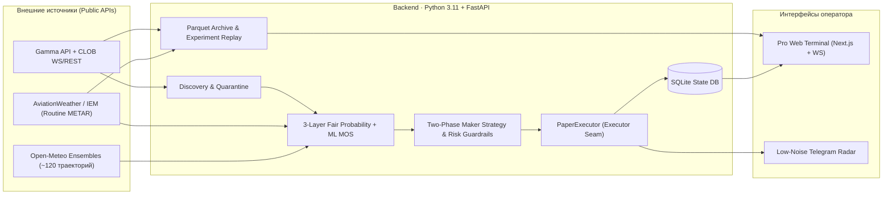

# Polymarket Daily Weather Quant Engine & Pro Terminal


Автономный квантовый движок, лаборатория воспроизводимых экспериментов (`Experiment Replay`), низкошумный Telegram-радар и тёмный веб-терминал (`Next.js`) для дневных температурных рынков Polymarket, расчёт которых идёт строго по официальным авиационным сводкам `Routine METAR` конкретных аэропортов (`Station` ICAO).

> **Статус безопасности:** публичный репозиторий работает в режиме симуляции (`PaperExecutor`) на открытых публичных API без реальных ключей и транзакций. Секреты, локальные базы и архивы исключены из Git и защищены автоматическим тестом-предохранителем.

## Постановка задачи и доменные ограничения

Дневные температурные рынки Polymarket (`Weather Event`, разделённые на взаимоисключающие `Bucket`-контракты) часто неэффективны из-за того, что розничные участники смотрят на бытовые прогнозы погоды, игнорируя правила расчёта биржи и микроструктуру стакана:

- **Точный источник истины (`Station` + `Routine METAR`):** расчёт рынка привязан к конкретному аэропорту ICAO (координаты и высота ВПП), а не «центру города». Принимаются только плановые сводки `METAR` (включая десятые доли из секции `RMK`), а внеплановые `SPECI` отбрасываются.
- **Отсутствие утечек во времени (Temporal Integrity):** все ML-признаки строятся строго из архивных прогнозов и наблюдений с `timestamp < decision_time`, с хронологическим разбиением выборок (`train < val < test`).
- **Микроструктура и контроль риска:** торговля ведётся только пассивными `Post-Only` `Maker Order` заявками (`0%` комиссии против taker-комиссий), с `0.2x` Fractional Kelly и жёсткими лимитами (`$5 / Bucket`, `$8 / City Exposure`, `40%` `Intraday Cash Reserve`).
- **Воспроизводимость решений:** каждое изменение модели или стратегии проверяется через детерминированный `Experiment Replay` по архивам `Parquet` по метрикам `Brier Score`, `Closing Line Value (CLV)`, `Max Drawdown` и `PnL`.

## Архитектура системы



## Аналитические и инженерные артефакты

| Артефакт | Назначение |
|---|---|
| [GLOSSARY.md](GLOSSARY.md) | Единый доменный глоссарий (Ubiquitous Language): термины погоды, ордербука, риска и версионирования |
| [docs/adr/](docs/adr/) | 4 Architecture Decision Records: [скоуп METAR](docs/adr/0001-pure-metar-station-scope.md), [гибридный MOS + ML](docs/adr/0002-hybrid-mos-ensemble-plus-quantile-ml.md), [двухфазный maker и шов Executor](docs/adr/0003-two-phase-maker-paper-engine-and-executor-seam.md), [разделение FastAPI / Next.js](docs/adr/0004-split-fastapi-backend-and-nextjs-terminal.md) |
| [docs/architecture/runtime-wiring.md](docs/architecture/runtime-wiring.md) | Карта сервисов, фоновых воркеров, `app.state` и HTTP/WebSocket-роутеров |
| [docs/experiments/README.md](docs/experiments/README.md) | Журнал гипотез и сравнений `Experiment Replay` (метрики до/после по версиям моделей) |
| [.scratch/weather-quant/spec.md](.scratch/weather-quant/spec.md) | Системная спецификация и 7 декомпозированных тикетов реализации |
| [CODING_STANDARDS.md](CODING_STANDARDS.md) | Стандарты разработки и автоматические архитектурные guardrails |

## Модули проекта

- **Backend (`backend/src/weather_quant/`, Python 3.11 + FastAPI)**:
  - **Discovery & METAR (`discovery/`, `metar/`)**: фильтрация рынков по строгому правилу `Routine METAR` (с отбрасыванием `SPECI` и разбором десятых долей `Remark Tenths`), точные координаты и высота ВПП `Station`, карантин неоднозначных контрактов.
  - **Hybrid Probability & MOS (`probability/`, `ml/`)**: 3-слойное распределение `Fair Probability` (~120 траекторий `ECMWF` + `GFS` + `ICON`, 30–45-дневный `Station Bias`, внутридневное отсечение невозможных `Bucket` по `Routine METAR`) + квантильные ML-модели (`LightGBM`/`CatBoost`) без утечек во времени.
  - **Two-Phase Maker Strategy & PaperExecutor (`strategy/`, `clob/`)**: двухфазный жизненный цикл (`Premarket Entry` и `Intraday Repricing`) только через пассивные `Post-Only` `Maker Order` (`0%` комиссии), `0.2x` Fractional Kelly, лимиты `$5 / Bucket`, `$8 / City Exposure`, `40%` `Intraday Cash Reserve`, учёт `Closing Line Value (CLV)`.
  - **Parquet Archive & Experiment Replay (`archive/`, `replay/`)**: детерминированный прогон кандидатных пар `(Model Version, Strategy Version)` по архивам `Parquet` без затрагивания живой БД.
  - **Low-Noise Telegram Radar (`telegram/radar_bot.py`, `api/routes_telegram.py`)**: дедуплицированные карточки на значимые переходы (`Edge >= 5¢`, исполнения и ранние выходы `PaperExecutor`, резкие сдвиги `Routine METAR`, дневной отчёт PnL и `CLV`) + команды `/status`, `/positions`, `/pause`, `/resume`.
- **Frontend (`frontend/`, Next.js + React)**:
  - Тёмный торговый терминал: портфельная шапка с фильтрацией по `Model Version` и `Strategy Version`, мульти-городской Screener по `Edge` с фильтром по датам расчёта, 11-`Bucket` City X-Ray с глубиной `CLOB` и интерактивным фан-графиком `Ensemble Distribution` + `Routine METAR`, таблица сравнения `Experiment Replay`.

## Быстрый запуск на Windows в 1 клик

1. (Опционально) скопируйте `.env.example` в `.env` и заполните ключи:
   ```powershell
   Copy-Item .env.example .env
   ```
   Если `TELEGRAM_BOT_TOKEN` и `TELEGRAM_CHAT_ID` не заданы, движок и терминал запускаются штатно, а Telegram-радар автоматически работает в безопасном отключённом режиме (`enabled: false`).

2. Запустите систему двойным кликом по [`start-terminal.bat`](start-terminal.bat) или через PowerShell:
   ```powershell
   powershell -NoProfile -ExecutionPolicy Bypass -File scripts\start-all.ps1
   ```

Скрипт `scripts/start-all.ps1`:
- загрузит переменные из `.env` (если файл создан);
- выставит `PYTHONPATH=backend\src`;
- автоматически создаст `.venv` и установит зависимости `frontend/node_modules`, только если они отсутствуют;
- запустит FastAPI backend (`http://127.0.0.1:8000`) и Next.js терминал (`http://localhost:3000`) в отдельных окнах;
- дождётся ответа `/api/health` и откроет `http://localhost:3000` в браузере.

### Основные адреса

- **Pro Web Terminal**: `http://localhost:3000`
- **FastAPI Swagger UI**: `http://127.0.0.1:8000/docs`
- **Health Check**: `http://127.0.0.1:8000/api/health`
- **Telegram Radar Status**: `http://127.0.0.1:8000/api/telegram/status`

## Настройка Telegram-радара

1. Создайте бота у `@BotFather` в Telegram и получите `TELEGRAM_BOT_TOKEN`.
2. Узнайте ваш `TELEGRAM_CHAT_ID` и пропишите оба значения в `.env` (файл `.env` исключён из git через `.gitignore`).
3. После старта проверьте статус и тестовую карточку через REST API:
   - `GET http://127.0.0.1:8000/api/telegram/status`
   - `POST http://127.0.0.1:8000/api/telegram/test-card`
   - `POST http://127.0.0.1:8000/api/telegram/command` с телом `{"command": "/status"}`

Поддерживаемые команды оператора в Telegram:
- `/status` — баланс, `Intraday Cash Reserve`, здоровье фидов, статус паузы, активные `Model Version` и `Strategy Version`.
- `/positions` — открытые `Bucket`-позиции и активные `Maker Order` заявки по городам.
- `/pause` / `/resume` — безопасная остановка или возобновление новых входов (фаза защиты риска остаётся активной).

## Запуск сравнений Experiment Replay

1. В веб-терминале (`http://localhost:3000`) откройте вкладку **Experiment Lab**, выберите `Model Version`, `Strategy Version` и диапазон дат, затем запустите симуляцию и сравните `Brier Score`, средний `Closing Line Value (CLV)`, fill rate, число сделок, max drawdown и чистый PnL.
2. Либо используйте REST API напрямую:
   - Запуск: `POST http://127.0.0.1:8000/api/replay/run`
   - История прогонов: `GET http://127.0.0.1:8000/api/replay/runs`
   - Промоут победителя: `POST http://127.0.0.1:8000/api/replay/promote`

## Проверки, pre-commit, безопасность и CI

Единая проверка всего проекта (бэкенд-тесты + архитектурные и security-предохранители, проверка типов TypeScript и тесты фронтенда):
```powershell
powershell -NoProfile -ExecutionPolicy Bypass -File scripts\check.ps1
```

Установить локальный Git `pre-commit` хук (запускает `scripts\check.ps1` автоматически перед каждым коммитом):
```powershell
powershell -NoProfile -ExecutionPolicy Bypass -File scripts\install-git-hooks.ps1
```

При запуске через `start-terminal.bat` живые логи обоих серверов пишутся в `logs\backend.log` и `logs\frontend.log` (папка `logs/` игнорируется git). На GitHub настроен workflow [`.github/workflows/ci.yml`](.github/workflows/ci.yml).

### Защита секретов и подключение к GitHub

- Файл `.gitignore` исключает `.env`, `.env.*` (кроме `.env.example`), `.venv/`, `node_modules/`, `.next/`, `*.tsbuildinfo`, локальные базы `data/*.db*`, модели `data/models/` и архивы `data/*.parquet`.
- Тест `test_no_tracked_secrets_or_private_keys` в [`backend/tests/test_09_architecture_guardrails.py`](backend/tests/test_09_architecture_guardrails.py) автоматически проверяет все отслеживаемые Git-файлы на случайное попадание `.env`, приватных ключей и токенов на каждом pre-commit и в GitHub CI.
- На GitHub рекомендуется дополнительно включить **Settings → Code security → Secret scanning & Push protection**.

Привязка удалённого репозитория и отправка ветки `main`:
```powershell
git branch -M main
git remote add origin https://github.com/<your-username>/<your-repo>.git
git push -u origin main
```
